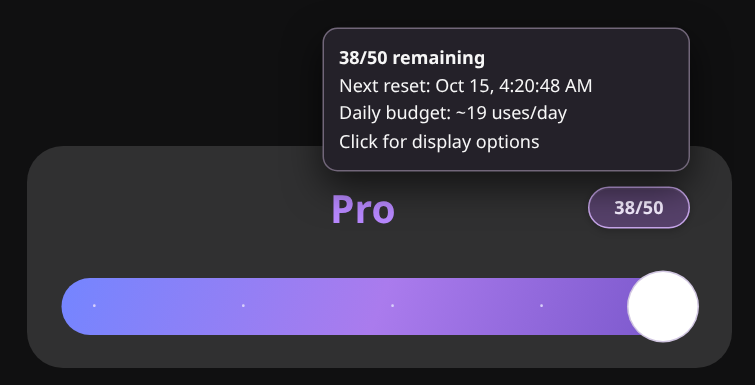

# ChatGPT Pro Quota Ledger

**See how many Pro messages you have left, right where you choose Pro.**

ChatGPT Pro Quota Ledger is a free, open-source [Tampermonkey](https://www.tampermonkey.net/) userscript that keeps a local estimate of your remaining Pro messages. It adds a small counter to ChatGPT's Power picker, with an optional floating widget for quick access anywhere in a chat.



## Install

1. Install **[Tampermonkey](https://www.tampermonkey.net/)** in Chrome or another compatible browser.
2. Open the [userscript](chatgpt-pro-quota-ledger.user.js) on GitHub, select **Raw**, and save the `.user.js` file. Or get the installation ZIP from [Releases](https://github.com/Temult/chatgpt-pro-quota-ledger/releases) and extract it.
3. In Tampermonkey, open **Dashboard → Utilities → Import from file** and select `chatgpt-pro-quota-ledger.user.js`.
4. Refresh ChatGPT. Open the Power picker with **Pro** selected to see the counter.

Already using an earlier version? Disable the old copy if Tampermonkey installs this as a separate script. Your existing ledger and preferences are preserved.

No API key, account connection, or build tools required.

## Features

- **Automatic Pro counting.** Tracks recognized Pro submissions as you use ChatGPT. No keyboard shortcut needed for normal use.
- **Counter in the picker.** A compact `38/50` pill appears beside the Power slider **only when Pro is selected**.
- **Choose where it appears.** Use the integrated pill, floating widget, or both. Change the placement from either interface.
- **Next reset and daily budget.** Hover for the expected reset time and an estimate of how many Pro messages you can use per day until then.
- **Subscription-aware settings.** Automatically recognizes the $100 Pro plan when ChatGPT provides its plan information. Other allowances can be configured under ⚙ Settings.
- **Manual corrections.** Add a use with `Ctrl+Shift+P` (or `Alt+Shift+P`) when automatic detection misses one. Automatic detection can reconcile that manual mark with a later submission.
- **Optional diagnostics.** Capture a short, privacy-filtered event log when something isn't counting correctly, then preview it before exporting.

## Using the counter

Click the pill to select **Picker only**, **Floating only**, or **Both**. **Full settings…** temporarily opens the floating settings panel, even in Picker-only mode. Close it and the counter returns to your previous placement unless you deliberately changed that preference.

The floating widget has **⚙ Settings** for the allowance, display placement, local profiles, and diagnostics, plus **ⓘ Information** for explanations of how estimates work.

Useful shortcuts:

| Shortcut | Action |
| --- | --- |
| `Ctrl+Shift+P` or `Alt+Shift+P` | Record one Pro use manually |
| `Alt+Shift+Q` | Restore both counter displays and open Settings |

To keep separate counts for different ChatGPT accounts, select a different **local profile** in the widget. Profiles are managed manually; they do not automatically follow your ChatGPT login. Counts are shared across tabs in the same browser storage profile, but **not across devices or separate browser profiles**.

## How accurate is it?

The number is **an estimate, not an official balance**. ChatGPT doesn't provide a continuously available remaining-Pro-message counter to this script, so it counts recognized submissions that the browser reports as accepted. A request that later fails, a retry, or a message sent on another device can make the estimate differ from the actual limit.

Reset dates come from ChatGPT when a restriction is reported. Otherwise the script shows a projected date. The daily budget is a planning calculation, not a separate daily quota. See [known limitations](docs/KNOWN_LIMITATIONS.md) for details.

## Questions people ask

**How can I see how many ChatGPT Pro messages I have left?** ChatGPT may show a reset time after you hit a limit, but it doesn't consistently expose a live remaining-message count. This userscript adds a local estimate. See [how to check Pro usage and reset times](docs/how-to-check-chatgpt-pro-usage.md).

**Does it track GPT-6 Pro and GPT-5.6 Sol Pro?** Yes, for recognized Pro submissions in regular ChatGPT conversations. It doesn't count separate Work or Codex usage.

**Can I use it across devices?** Each browser profile keeps its own ledger. There is no account-wide synchronization.

## Privacy

Everything stays in your browser. There is **no telemetry, external service, or additional network polling**. The ledger stores message-count metadata, not your prompts or replies. Diagnostics are off by default and can be previewed and cleared independently of your counter.

Browser storage is not private from other scripts running on the same site, and older pre-v0.2 ledger data may still contain message identifiers. See [Security and privacy](SECURITY.md) before sharing diagnostic reports.

## Development

The complete extension is one `.user.js` file. Node.js 22+ is needed only to run the development tests:

```bash
npm run check
```

For Chromium integration tests, install the Python dependencies and run:

```bash
python -m pip install -r requirements-dev.txt
python -m playwright install chromium
python scripts/run_browser_tests.py
```

Further documentation: [Architecture](docs/ARCHITECTURE.md) · [Testing](docs/TESTING.md) · [Diagnostics](docs/DIAGNOSTICS.md) · [Contributing](CONTRIBUTING.md) · [Releasing](docs/RELEASING.md).

## License and credits

Released under the [MIT License](LICENSE). The approach to reading ChatGPT's existing quota metadata was inspired by [BlueSkyXN's ChatGPT Quota Helper](https://github.com/BlueSkyXN/CPA-Panel-LTS/blob/main/scripts/chatgpt-quota-helper.js); see [third-party notices](THIRD_PARTY_NOTICES.md).

Not affiliated with or endorsed by OpenAI.
